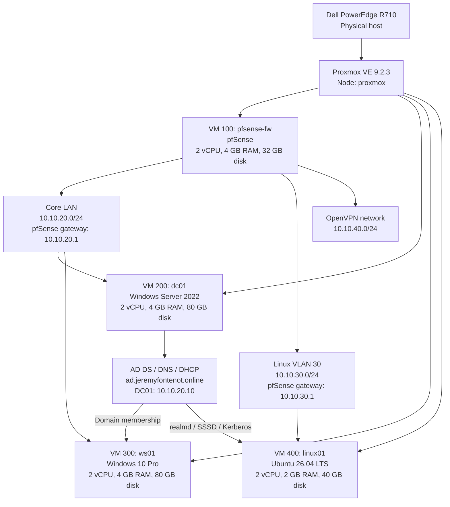

# Infrastructure Overview

## Environment

I operate my hybrid infrastructure lab on a Dell PowerEdge R710 host. I run Proxmox VE 9.2.3 on that host and use it to manage the primary virtual systems in the environment.

I use four primary virtual machines in this environment:

| VMID | Hostname | Guest system or role | Resource allocation | Proxmox network placement |
|---|---|---|---|---|
| 100 | pfsense-fw | pfSense firewall and routing platform | 2 vCPU, 4 GB RAM, 32 GB disk | vmbr0 and vmbr1 |
| 200 | dc01 | Windows Server 2022 domain controller | 2 vCPU, 4 GB RAM, 80 GB disk | vmbr1 |
| 300 | ws01 | Windows 10 Pro domain-joined client | 2 vCPU, 4 GB RAM, 80 GB disk | vmbr1 |
| 400 | linux01 | Ubuntu 26.04 LTS domain-integrated system | 2 vCPU, 2 GB RAM, 40 GB disk | vmbr1, VLAN tag 30 |

I use DC01 for the `ad.jeremyfontenot.online` domain services. I operate WS01 as a domain-joined Windows client. I configured Linux01 through realmd for the AD domain, using SSSD and Kerberos for domain identity integration.

I assigned DC01 `10.10.20.10/24`, WS01 `10.10.20.100/24`, and Linux01 `10.10.30.20/24`. I use `10.10.20.1` as the pfSense core-LAN gateway and `10.10.30.1` as the Linux-VLAN gateway. I document DC01 and WS01 on vmbr1 and Linux01 on vmbr1 with VLAN tag 30; I do not infer VLAN tags for the Windows systems from their bridge placement.

## Architectural Relationships

I use Proxmox as the virtualization and VM lifecycle platform for the lab. My inventory lists pfsense-fw, dc01, ws01, and linux01 with the resource allocations and bridge placement shown above.

I use pfSense as VM 100 at the network boundary. My Proxmox inventory places VM 100 on vmbr0 and vmbr1. I configure `10.10.20.1` as the core-LAN gateway and `10.10.30.1` as the Linux-VLAN gateway. I use `10.10.40.0/24` as the OpenVPN network.

I use DC01 as VM 200 for Windows Server and directory services. My direct inventory records Windows Server 2022 Standard Evaluation and the Active Directory Domain Services, DNS Server, DHCP Server, and Group Policy Management roles or features on the system. I configured DC01 as `DC01.ad.jeremyfontenot.online` in the `JFAD` NetBIOS domain, and I recorded the PDC Emulator, RID Master, Infrastructure Master, Schema Master, and Domain Naming Master roles on DC01.

I use WS01 as VM 300 for the Windows client tier. I run Windows 10 Pro on it with Ethernet IPv4 address `10.10.20.100/24`, gateway `10.10.20.1`, and DNS and DHCP server `10.10.20.10`. I recorded its membership in `ad.jeremyfontenot.online` and a secure-channel result of true.

I use Linux01 as VM 400 for Linux administration and domain integration. I run Ubuntu 26.04 LTS on VLAN 30 with address `10.10.30.20/24`, gateway `10.10.30.1`, and DNS server `10.10.20.10`. I configured realmd for `ad.jeremyfontenot.online`, use SSSD as the identity client, and maintain Kerberos configuration.

## Infrastructure Administration

I administer the environment through system inventory, network configuration review, domain and DNS checks, Linux identity administration, VM administration, and evidence collection. My primary records cover VM inventory and resource allocations, domain roles, Windows client network and domain state, Linux networking and identity integration, and the relationships among the virtual systems.

I route between the core Windows network and Linux VLAN through pfSense. My route evidence records a route for `10.10.20.0/24` through `10.10.40.1` from `10.10.40.2`.

## Evidence Scope

I use the Proxmox inventory to document the platform, VM assignments, allocations, and bridge placement. I use target-local inventories to document the operating system, network, and domain details I collected from DC01, WS01, and Linux01.

## Primary Evidence

- [Proxmox platform inventory](../../../evidence-library/projects/on-prem-home-lab/current-validated-state/direct-evidence/proxmox-platform-inventory.md)
- [DC01 validation](../../../evidence-library/projects/on-prem-home-lab/current-validated-state/direct-evidence/dc01-system-and-role-validation.md)
- [WS01 validation](../../../evidence-library/projects/on-prem-home-lab/current-validated-state/direct-evidence/ws01-system-and-domain-validation.md)
- [Linux01 validation](../../../evidence-library/projects/on-prem-home-lab/current-validated-state/direct-evidence/linux01-system-network-domain-validation.md)
