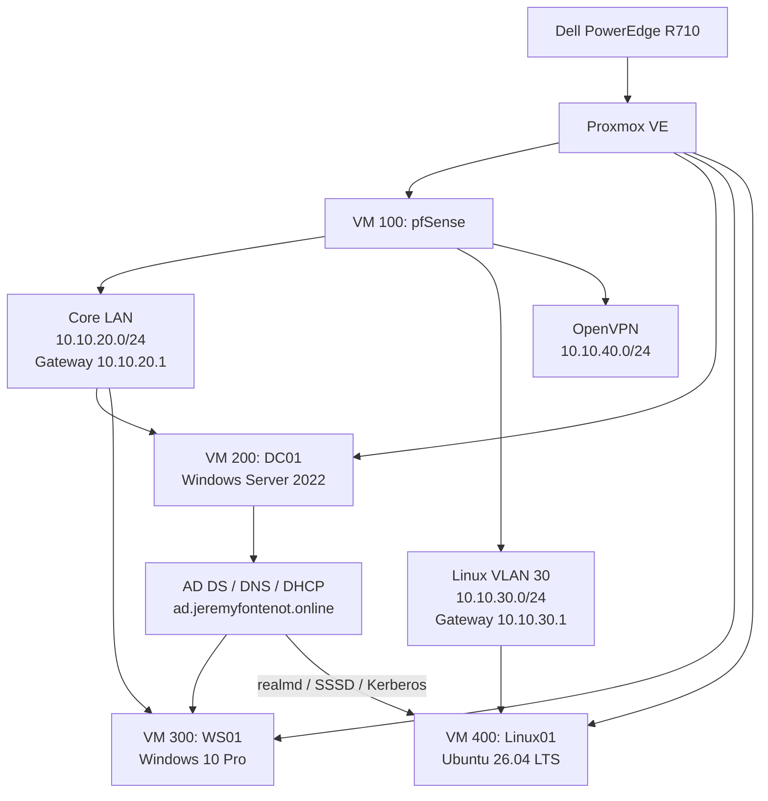

# Infrastructure Overview

## Recorded Core Guest Inventory

I configured four primary Proxmox guests to provide the core network, identity, Windows client, and Linux services in my lab.

| VMID | Hostname | Guest system or role | vCPU | Memory | Disk | Network placement |
|---|---|---|---:|---:|---:|---|
| 100 | pfsense-fw | pfSense firewall and routing platform | 2 | 4 GB | 32 GB | vmbr0 and vmbr1 |
| 200 | dc01 | Windows Server 2022 domain controller | 2 | 4 GB | 80 GB | vmbr1 |
| 300 | ws01 | Windows 10 Pro domain-joined client | 2 | 4 GB | 80 GB | vmbr1 |
| 400 | linux01 | Ubuntu 26.04 LTS domain-integrated Linux system | 2 | 2 GB | 40 GB | vmbr1, VLAN tag 30 |

I configured DC01 for the `ad.jeremyfontenot.online` domain, DNS, and DHCP services. I use WS01 as my domain-joined Windows client. I integrated Linux01 with the Active Directory domain through realmd, SSSD, and Kerberos.

## Network and Identity Relationships

I assign DC01 `10.10.20.10/24` and WS01 `10.10.20.100/24` on the core LAN. I assign Linux01 `10.10.30.20/24` on VLAN 30. I use `10.10.20.1` as the core-LAN gateway, `10.10.30.1` as the Linux-VLAN gateway, and `10.10.20.10` as the internal DNS server.

I use `10.10.40.0/24` for OpenVPN remote administration. pfSense routes traffic between the core LAN and Linux VLAN and provides the VPN gateway for remote clients.

## Distinct Layers and Administrative Responsibility

| Infrastructure layer | Systems and platforms | My administrative responsibility |
|---|---|---|
| Physical | Dell PowerEdge R710 | I administer the compute, memory, storage, and physical network platform that hosts Proxmox VE |
| Hypervisor | Proxmox VE | I manage virtual machines, virtual disks, Linux bridges, VLAN-aware networking, snapshots, backup jobs, and restore exercises |
| Network | pfSense, vmbr0, vmbr1, core LAN, Linux VLAN, OpenVPN | I configure network segmentation, routing, remote access, and firewall gateway relationships between lab networks |
| Windows identity | DC01, Active Directory Domain Services, DNS, DHCP, Group Policy | I administer the AD domain, directory roles, name resolution, address assignment, organizational units, and Group Policy |
| Windows endpoint | WS01 | I manage domain membership, workstation networking, Remote Desktop, Group Policy application, and file-share access |
| Linux services | Linux01, Ubuntu, realmd, SSSD, Kerberos, rsyslog | I administer Linux networking, Active Directory identity integration, SSH access, service troubleshooting, and syslog receiver configuration |
| Nested virtualization | HVHOST01, Hyper-V, VMM01, SCVMM, APP01 | I manage the Hyper-V host through SCVMM and operate the APP01 guest through VMM lifecycle and console tools |
| Hybrid identity and cloud management | SYNC01, Microsoft Entra Cloud Sync, Microsoft Entra Connect Sync, Azure Arc, Windows Admin Center | I administer two separate tenant-specific synchronization implementations and connect supported Windows management systems and SQL resources to Azure Arc |

## Architecture Diagram

## Administration

I administer the environment through Proxmox VM and storage management, pfSense routing, Windows directory services, Linux identity integration, remote administration, backup and restore operations, and PowerShell-based inventory and troubleshooting.

## Evidence

- [Proxmox platform inventory](../../../evidence-library/projects/on-prem-home-lab/current-validated-state/direct-evidence/proxmox-platform-inventory.md)
- [DC01 system and role inventory](../../../evidence-library/projects/on-prem-home-lab/current-validated-state/direct-evidence/dc01-system-and-role-validation.md)
- [WS01 system and domain inventory](../../../evidence-library/projects/on-prem-home-lab/current-validated-state/direct-evidence/ws01-system-and-domain-validation.md)
- [Linux01 system, network, and domain inventory](../../../evidence-library/projects/on-prem-home-lab/current-validated-state/direct-evidence/linux01-system-network-domain-validation.md)
