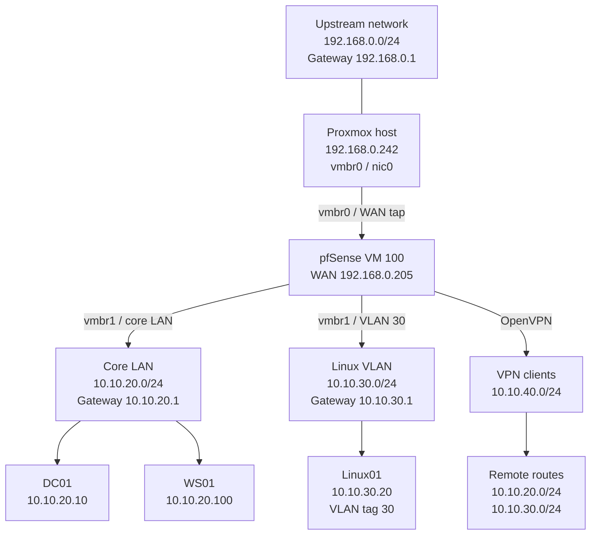

# Network Architecture

## Network Overview

I designed my lab network around pfSense. I configured it to route between the core LAN and Linux VLAN, provide the OpenVPN remote-access gateway, and connect the internal networks to the upstream network. I used Proxmox Linux bridges to connect the firewall and guest interfaces to their network segments.

## Network Segments

| Network segment | Network address | Gateway or endpoint | Systems and purpose |
|---|---|---|---|
| Upstream network | 192.168.0.0/24 | 192.168.0.1 | Proxmox management at 192.168.0.242 and pfSense WAN at 192.168.0.205 |
| Core LAN | 10.10.20.0/24 | 10.10.20.1 | DC01, WS01, Active Directory, DNS, DHCP, and core Windows services |
| Linux VLAN 30 | 10.10.30.0/24 | 10.10.30.1 | Linux01 and Linux administration services |
| Remote-access VPN | 10.10.40.0/24 | 10.10.40.1 | OpenVPN remote administrative connectivity |

I assigned DC01 `10.10.20.10/24` and WS01 `10.10.20.100/24` on the core LAN. I assigned Linux01 `10.10.30.20/24` on VLAN 30. I used DC01 at `10.10.20.10` for internal DNS and DHCP services.

## Network Topology

## Proxmox Network Bridges

I used two Proxmox Linux bridges to connect the physical host, pfSense, and virtual machines.

| Bridge | Host configuration | Network role |
|---|---|---|
| `vmbr0` | Static address `192.168.0.242/24`, gateway `192.168.0.1`, bridge port `nic0` | I used this bridge for Proxmox management and the pfSense WAN connection to the upstream network |
| `vmbr1` | Manual addressing, no physical bridge ports, VLAN-aware, VLAN IDs 2–4094 | I used this bridge for the pfSense LAN and internal guest interfaces |

I connected the pfSense WAN interface through `vmbr0`. I connected the pfSense LAN and internal guest interfaces through `vmbr1`. I assigned Linux01 VLAN tag 30 so its virtual interface belonged to the Linux VLAN.

## Routing and DNS

I configured pfSense to route traffic between the core LAN and Linux VLAN. The core LAN uses `10.10.20.1` as its gateway, and the Linux VLAN uses `10.10.30.1`.

I configured DC01 at `10.10.20.10` as the DNS server for `ad.jeremyfontenot.online`. I configured WS01 to obtain DHCP network settings from DC01 and use DC01 for DNS. I configured Linux01 to use DC01 for DNS across the routed connection.

## Remote Administration

I configured pfSense OpenVPN remote access with the `10.10.40.0/24` address space. From my VPN client at `10.10.40.2`, I routed traffic through `10.10.40.1` to reach the core LAN and Linux VLAN.

## Centralized Logging

I configured pfSense to forward selected system, firewall, authentication, VPN, and gateway events to Linux01 at `10.10.30.20:514`. I configured Linux01 rsyslog to listen for the forwarded messages over TCP and UDP.

## Evidence

- [Home lab inventory and network validation](../../../evidence-library/projects/on-prem-home-lab/current-validated-state/source-summaries/home-lab-inventory-validation.md)
- [Proxmox network bridge configuration](../../../evidence-library/projects/on-prem-home-lab/validated-2026-06-21/text/proxmox-network-validation-sanitized.txt)
- [Linux01 network and domain inventory](../../../evidence-library/projects/on-prem-home-lab/current-validated-state/direct-evidence/linux01-system-network-domain-validation.md)
