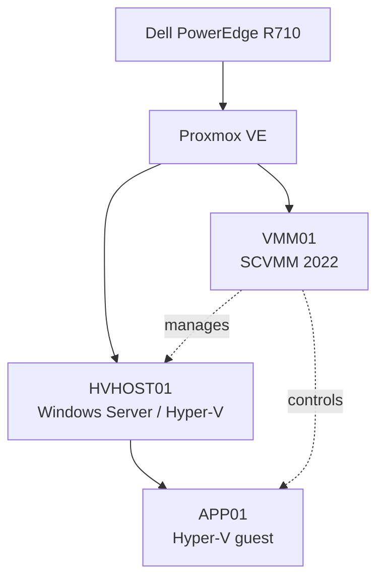
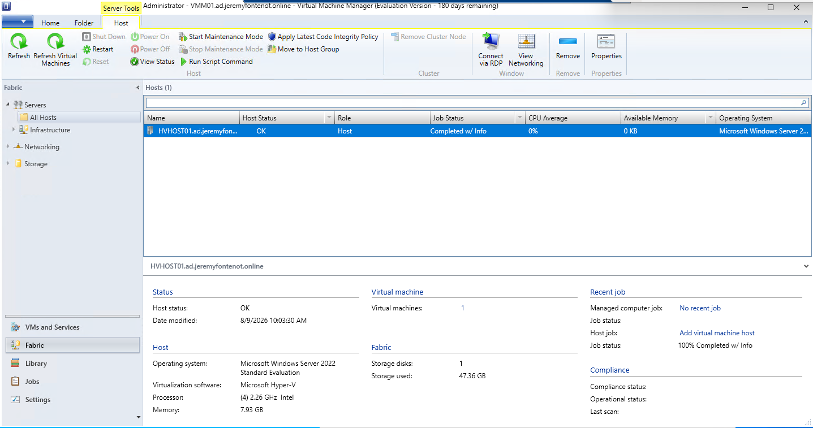
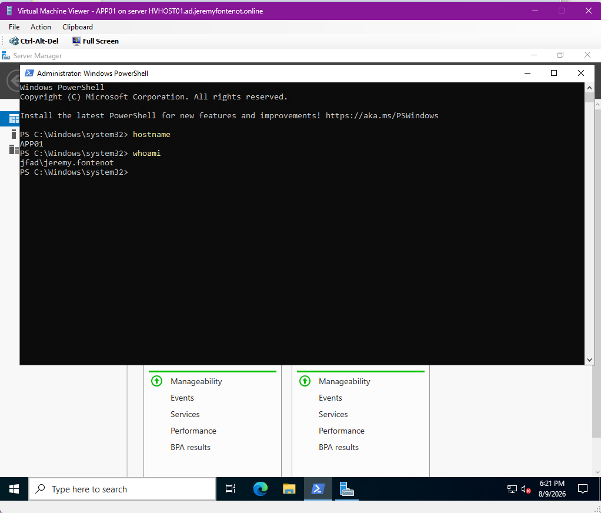

# Virtualization Architecture

## Proxmox Virtualization Layer

I use Proxmox VE on my Dell PowerEdge R710 as the base virtualization platform for the core lab systems. I configured the core guest set around pfSense, DC01, WS01, and Linux01. The shared VMIDs, guest roles, resource allocations, and bridge placement are recorded in the [Infrastructure Overview](infrastructure-overview.md#recorded-core-guest-inventory) and [Infrastructure Inventory](../reference/infrastructure-inventory.md#core-guest-inventory).

I use the Proxmox interface to review VM configuration, allocated resources, bridge placement, guest-agent integration, snapshots, storage, and backup jobs.

## Nested Hyper-V and SCVMM

I use HVHOST01 as a Windows Server Hyper-V host and VMM01 as my System Center Virtual Machine Manager management server. I installed the SCVMM management server and console, added HVHOST01 to the managed host inventory, and used VMM to discover APP01 on the Hyper-V host.

I use VMM to control APP01 remotely and open an interactive Virtual Machine Viewer session to the guest. I also use the VMM networking workspace to administer logical network and host networking relationships.

## Virtual Machine Lifecycle

I manage virtual machine lifecycle tasks through inventory review, provisioning, startup and shutdown operations, snapshot creation, backup configuration, isolated restore testing, guest inspection, and cleanup.

For my Linux01 restore exercise, I restored source VM 400 to temporary VM 401. I isolated the temporary VM network before boot, checked the Ubuntu guest and QEMU Guest Agent, then shut down and removed the temporary VM.

## Screenshots

I use the following screenshots to show the Hyper-V host and guest management work I perform through SCVMM.

## Evidence

- [Proxmox platform inventory](../../../evidence-library/projects/on-prem-home-lab/current-validated-state/direct-evidence/proxmox-platform-inventory.md)
- [Proxmox backup configuration](../../../evidence-library/projects/on-prem-home-lab/current-validated-state/direct-evidence/proxmox-backup-configuration.md)
- [Proxmox restore exercise](../../../evidence-library/projects/on-prem-home-lab/current-validated-state/direct-evidence/proxmox-restore-validation.md)
- [SCVMM screenshot and evidence manifest](../../../evidence-library/projects/on-prem-home-lab/scvmm-2022/evidence-manifest.json)
