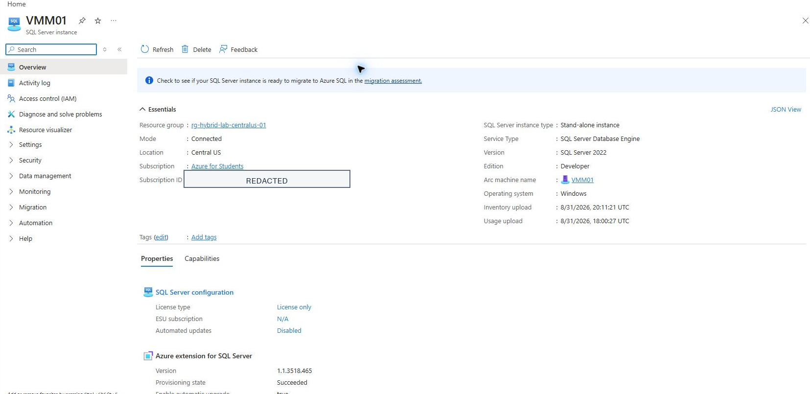

# Hybrid Identity and Cloud Integration

## Active Directory Identity Integration

I use the Active Directory domain `ad.jeremyfontenot.online` as the identity foundation for my Windows and Linux lab systems. I administer domain services on DC01 and integrate Linux01 with the domain through realmd, SSSD, and Kerberos.

I use SSSD for Linux identity resolution and SSH authentication. I diagnosed and corrected an SSSD responder and socket configuration conflict on Linux01, then verified directory identity lookup and a new AD-authenticated SSH session.

## Microsoft Entra Connect

I operate Microsoft Entra Connect on SYNC01 at `10.10.20.105`. I administer the ADSync service and Azure AD Connect Health agent, review their service state and event logs, and troubleshoot the DNS and outbound HTTPS dependencies used by the synchronization and health services.

I use target-side connectivity checks to resolve update and health endpoints, verify outbound TCP 443 connectivity, and run the Entra Connect Health connectivity test for the Sync role. I use these checks to investigate agent registration and health-data reporting.

## Azure Arc

I connect HVHOST01 and VMM01 to Azure Arc. On HVHOST01, I administer the Connected Machine agent and its supporting services, review agent connectivity, and verify outbound access to `gbl.his.arc.azure.com` over TCP 443.

I use Azure Arc to represent the VMM01 SQL Server 2022 Developer instance as a connected SQL resource. I review the SQL Server extension, its provisioning result, and the DPS and metrics-upload indicators.

## Windows Admin Center

I use Windows Admin Center to review server connections and Azure Arc connection state for HVHOST01 and VMM01. I maintain separate Windows and Azure sign-in contexts when using the management interface.

## Evidence

- [Linux01 Active Directory integration](../../../evidence-library/projects/on-prem-home-lab/current-validated-state/direct-evidence/linux01-system-network-domain-validation.md)
- [Linux01 SSSD remediation](../../../evidence-library/projects/on-prem-home-lab/current-validated-state/direct-evidence/linux01-sssd-remediation-validation.md)
- [Azure Arc public validation](../../../evidence-library/projects/on-prem-home-lab/azure-arc-hybrid-management/evidence/azure-arc-validation-public.txt)
- [Azure Arc screenshots and evidence manifest](../../../evidence-library/projects/on-prem-home-lab/azure-arc-hybrid-management/evidence-manifest.json)
