# Hybrid Identity and Cloud Integration

## Active Directory Identity Foundation

I use the Active Directory domain `ad.jeremyfontenot.online` as the identity foundation for my Windows and Linux lab systems. I administer domain services on DC01 at `10.10.20.10` and integrate Linux01 with the domain through realmd, SSSD, and Kerberos.

I use SSSD for Linux identity resolution and SSH authentication. I diagnosed and corrected an SSSD responder and socket configuration conflict on Linux01, then verified directory identity lookup and a new AD-authenticated SSH session.

## Separate Microsoft Entra Tenant Integrations

I administered two separate Microsoft Entra tenant integrations. I document them as distinct implementations because each integration targets a different tenant and uses a different synchronization technology.

| Entra directory | Synchronization method | Active Directory source | Synchronization host | Tenant-specific scope or connector |
|---|---|---|---|---|
| Personal Default Directory — `jeremyfontenot.online` | Microsoft Entra Cloud Sync | `ad.jeremyfontenot.online`, served by DC01 | SYNC01 | `OU=Cloud Sync,OU=JFAD,DC=ad,DC=jeremyfontenot,DC=online` |
| Microsoft 365 Developer tenant — `dev.jeremyfontenot.online` (`1x76s5767.onmicrosoft.com`) | Microsoft Entra Connect Sync | AD connector `ad.jeremyfontenot.online` | SYNC01 | Entra connector `1x76s5767.onmicrosoft.com - AAD` |

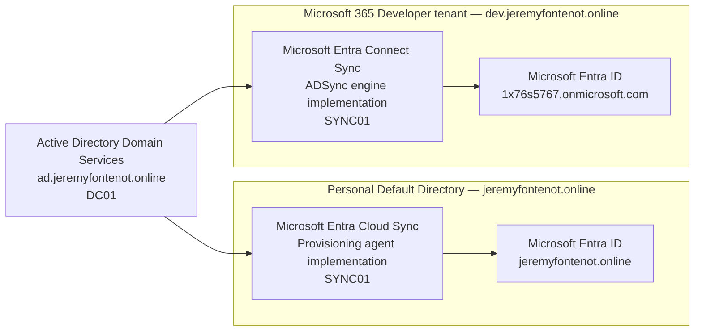

The two paths represent separate tenant-specific implementations. I do not describe them as competing synchronization engines for one tenant.

## Personal Default Directory: Microsoft Entra Cloud Sync

I configured Microsoft Entra Cloud Sync to synchronize selected identities from my on-premises Active Directory domain to the personal Default Directory with the verified domain `jeremyfontenot.online`.

### Architecture and Scope

| Component | Configuration |
|---|---|
| Active Directory domain controller | DC01, Windows Server 2022, `10.10.20.10` |
| Active Directory domain | `ad.jeremyfontenot.online` |
| Cloud Sync agent host | SYNC01, Windows Server 2022, `10.10.20.105` |
| Provisioning agent service | `AADConnectProvisioningAgent` |
| Agent service identity | Group Managed Service Account (gMSA) |
| Synchronization direction | Active Directory to Microsoft Entra ID |
| OU scope | `OU=Cloud Sync,OU=JFAD,DC=ad,DC=jeremyfontenot,DC=online` |
| Password Hash Synchronization | Enabled for the tested identities |

I used a dedicated Cloud Sync OU to scope the synchronized objects rather than selecting unrelated directory objects across the domain.

### Identity Lifecycle and Synchronization

I validated the Cloud Sync identity lifecycle with the controlled account `cloudsync.test01@jeremyfontenot.online` and the security group `GG-CloudSync-Test`.

| Task | Work I performed | Result demonstrated |
|---|---|---|
| User provisioning | Created the test identity in the scoped Active Directory OU | The user provisioned to Microsoft Entra ID |
| Attribute synchronization | Set the on-premises `Department` attribute to `Hybrid Identity Lab` | The same attribute value appeared in Microsoft Entra ID |
| Password Hash Synchronization | Changed the password in Active Directory and authenticated to Microsoft Entra ID with the updated password | The updated password authenticated successfully |
| Security-group synchronization | Created `GG-CloudSync-Test` as a global security group in the scoped OU | The group provisioned to Microsoft Entra ID |
| Group-membership synchronization | Added the test identity as a direct member of the group | The membership relationship synchronized |
| Source-anchor correlation | Compared the AD `objectGUID`, Cloud Sync source anchor, and Entra immutable ID | The identifiers correlated to the same source identity |
| Provisioning-log analysis | Reviewed user and group provisioning records | I used source, target, scope, and result details to trace provisioning behavior |

I accounted for the separate processing intervals during validation: the observed Users and Groups provisioning interval was 20 minutes, and the Password Hash Synchronization interval was 5 minutes.

### Cloud Sync Agent Troubleshooting

I investigated a Cloud Sync agent metrics error involving denied access to the registry key `Global` (Event ID 12033). I reviewed the provisioning agent's service identity and local group permissions on SYNC01, then added the agent gMSA to the local `Performance Log Users` group.

After restarting the provisioning agent service, I verified that the metrics agent initialized successfully (Event ID 14013). I also used the user provisioning, group provisioning, and Password Hash Synchronization tests to validate the identity workflows.

### Cloud Sync Screenshots

I use these sanitized screenshots to show the architecture, OU scope, identity lifecycle, and supporting synchronization evidence.

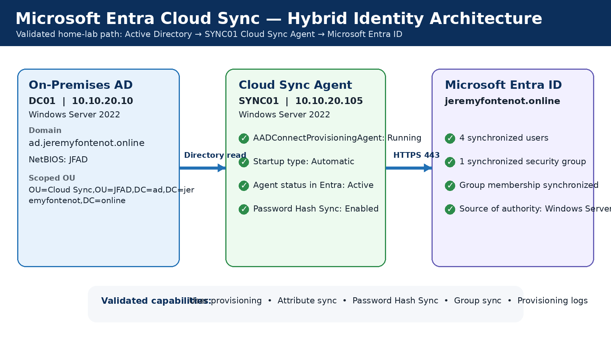

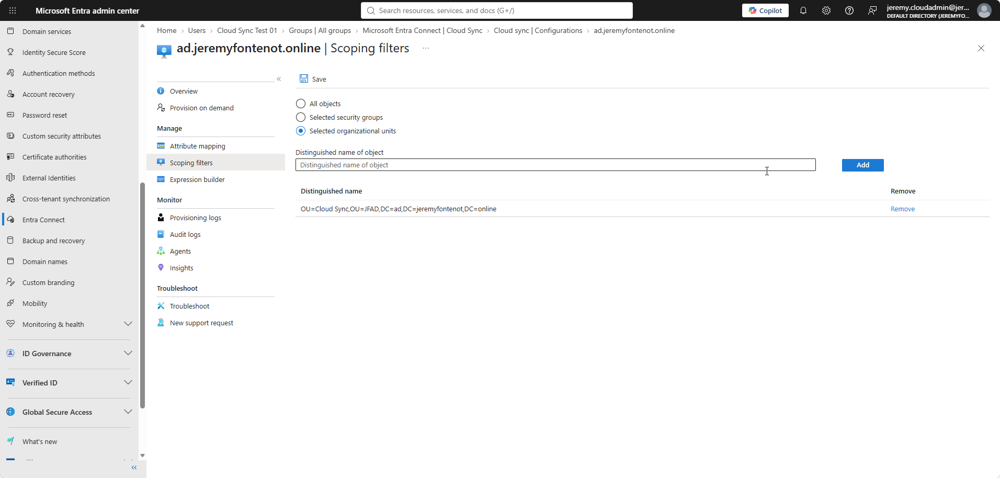

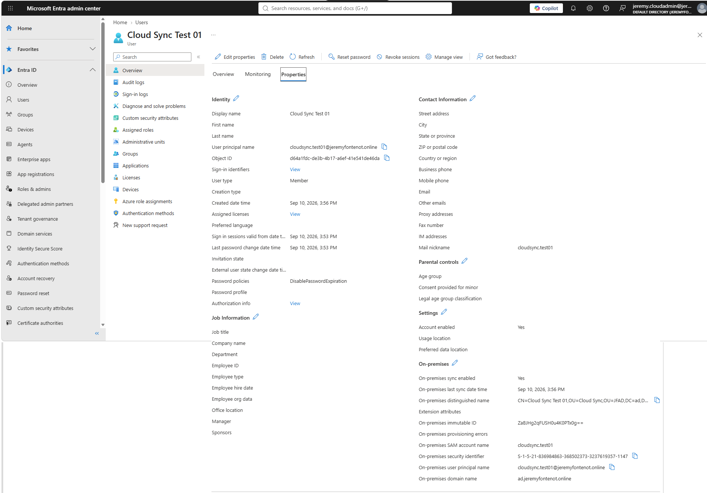

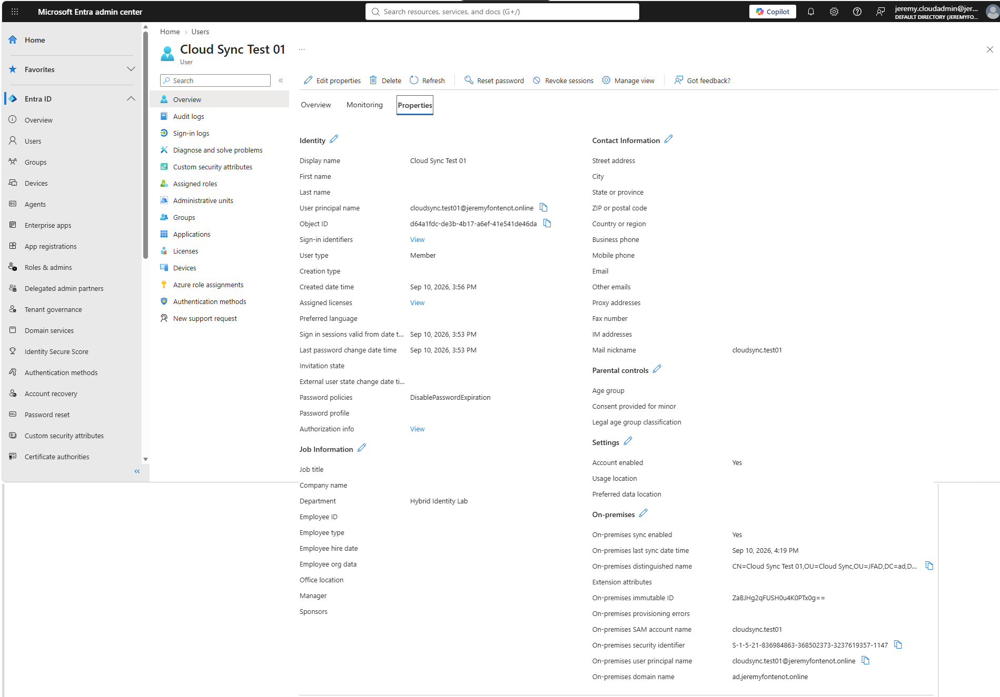

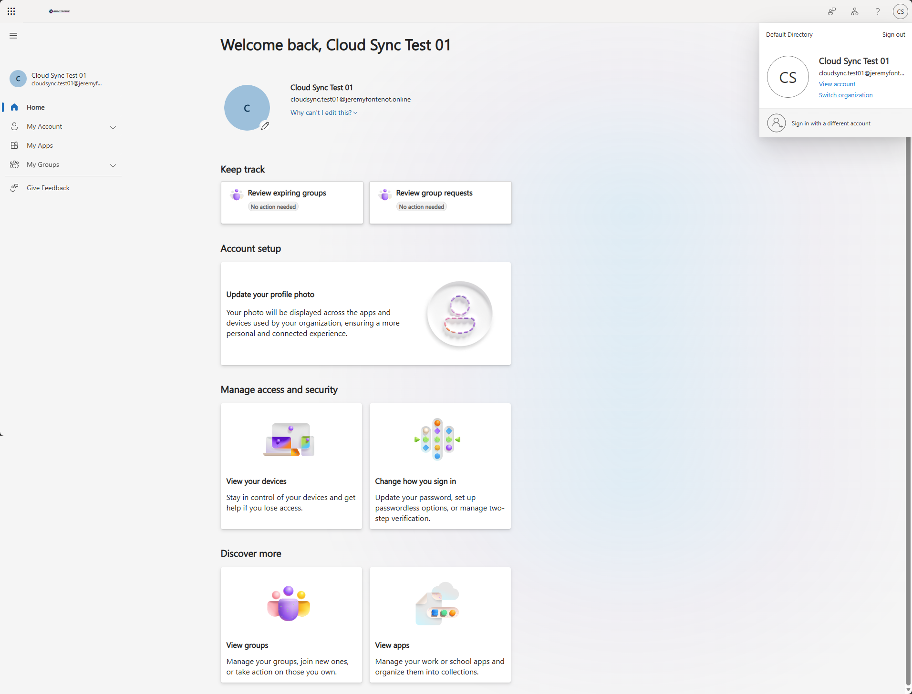

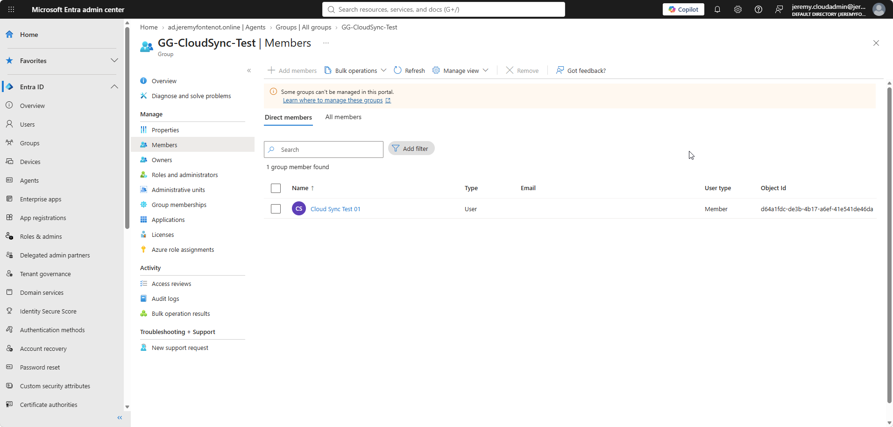

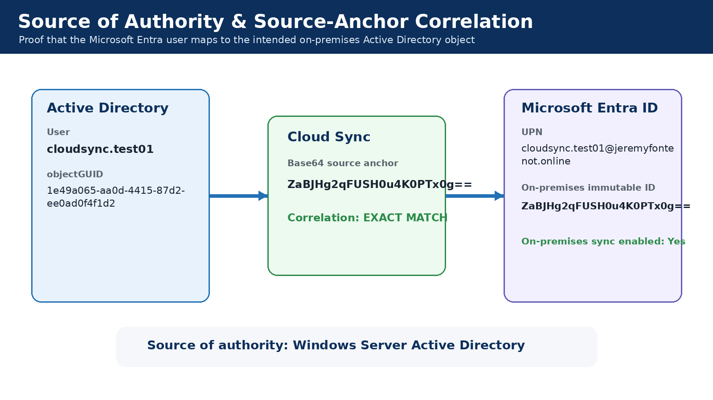

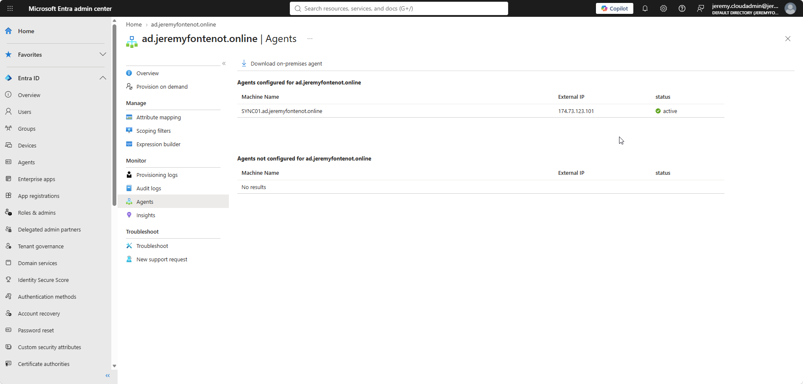

## Microsoft 365 Developer Tenant: Microsoft Entra Connect Sync

I installed and administered Microsoft Entra Connect Sync on SYNC01 for the separate Microsoft 365 Developer tenant. The tenant uses the custom domain `dev.jeremyfontenot.online` and the tenant namespace `1x76s5767.onmicrosoft.com`.

### Connect Sync Engine and Connectors

| Component | Observed configuration |
|---|---|
| Synchronization server | SYNC01, Windows Server 2022, `10.10.20.105` |
| Microsoft Entra Connect version | 2.6.92.0 |
| Active Directory connector | `ad.jeremyfontenot.online` (`AD`) |
| Microsoft Entra connector | `1x76s5767.onmicrosoft.com - AAD` (`Extensible2`) |
| Synchronization service | `ADSync` |
| Agent updater service | `AzureADConnectAgentUpdater` |
| Connect Health service | `AzureADConnectHealthAgent` |

I inspected the synchronization connector inventory through the ADSync module:

```powershell
Import-Module ADSync
Get-ADSyncConnector | Select-Object Name, Type
```

I also reviewed the synchronization and supporting service inventory with PowerShell:

```powershell
Get-CimInstance Win32_Service |
    Where-Object Name -in @(
        'ADSync',
        'AzureADConnectAgentUpdater',
        'AzureADConnectHealthAgent'
    ) |
    Select-Object Name, State, StartMode
```

### Connect Health and Connectivity Diagnostics

I investigated the Entra Connect Health reporting and update dependencies on SYNC01. I reviewed the agent updater event log, resolved `autoupdate.msappproxy.net` through DNS, and verified outbound TCP 443 connectivity to the resolved endpoint.

I ran the Sync-role connectivity test from the system context:

```powershell
Test-MicrosoftEntraConnectHealthConnectivityAsSystem -Role Sync
```

I used the test results to review sign-in and Health service endpoint connectivity, the EventHub data-upload path, and agent registration. The endpoint connectivity checks succeeded, and I validated the agent registration path.

### Synchronization Technology Distinction

I distinguish the two synchronization technologies by their service architecture and administrative controls:

| Microsoft Entra Cloud Sync | Microsoft Entra Connect Sync |
|---|---|
| Uses the `AADConnectProvisioningAgent` provisioning agent | Uses the `ADSync` synchronization engine |
| Uses cloud-managed provisioning configuration and service-managed Users and Groups processing | Uses configured connectors and the Connect Sync scheduler |
| Uses its own provisioning intervals and provisioning logs | Supports administrator-triggered synchronization cycles through the ADSync module |
| `Start-ADSyncSyncCycle` does not trigger a Cloud Sync provisioning cycle | `Start-ADSyncSyncCycle` is an Entra Connect Sync administrative command |

This distinction helped me select the correct service, diagnostic method, and synchronization controls for each tenant integration.

## Azure Arc

I connected HVHOST01 and VMM01 to Azure Arc. On HVHOST01, I administered the Connected Machine agent and its supporting services, reviewed agent connectivity, and verified outbound access to `gbl.his.arc.azure.com` over TCP 443.

I used Azure Arc to represent the VMM01 SQL Server 2022 Developer instance as a connected SQL resource. I reviewed the SQL Server extension, its provisioning result, and the DPS and metrics-upload indicators.

## Windows Admin Center

I used Windows Admin Center to review server connections and Azure Arc connection state for HVHOST01 and VMM01. I maintained separate Windows and Azure sign-in contexts when using the management interface.

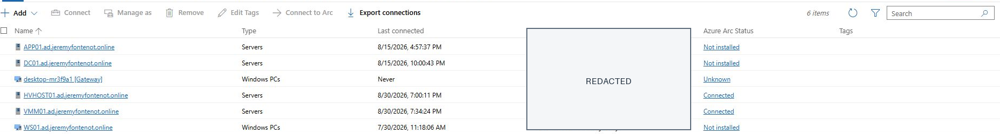

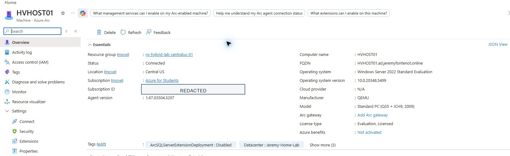


## Evidence

- [Cloud Sync evidence manifest and sanitized screenshot index](../../../projects/entra-cloud-sync/evidence/README.md)
- [Azure Arc public validation](../../../evidence-library/projects/on-prem-home-lab/azure-arc-hybrid-management/evidence/azure-arc-validation-public.txt)
- [Azure Arc screenshots and evidence manifest](../../../evidence-library/projects/on-prem-home-lab/azure-arc-hybrid-management/evidence-manifest.json)
- [Linux01 Active Directory integration](../../../evidence-library/projects/on-prem-home-lab/current-validated-state/direct-evidence/linux01-system-network-domain-validation.md)
- [Linux01 SSSD remediation](../../../evidence-library/projects/on-prem-home-lab/current-validated-state/direct-evidence/linux01-sssd-remediation-validation.md)
