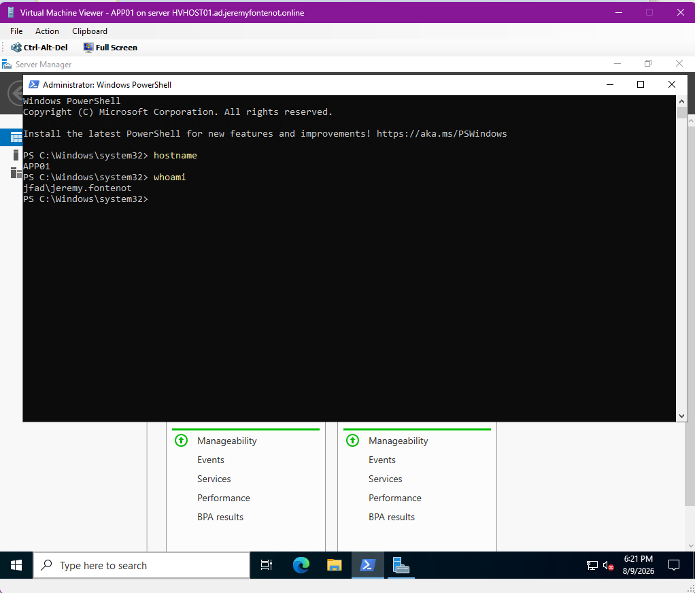

# Remote Access

## OpenVPN Remote Administration

I use pfSense OpenVPN remote access to connect my Windows 11 administration workstation, LT-JF01, to my lab networks. I use the `10.10.40.0/24` VPN address space and the tunnel gateway `10.10.40.1`.

I configure the OpenVPN client for service-based startup so the VPN connection can be established before Windows sign-in. I use the OpenVPN Windows service and interactive service to support the client connection workflow.

| VPN setting | Value |
|---|---|
| VPN network | 10.10.40.0/24 |
| Client address | 10.10.40.2 |
| Tunnel gateway | 10.10.40.1 |
| Core LAN route | 10.10.20.0/24 via 10.10.40.1 |
| Linux VLAN route | 10.10.30.0/24 via 10.10.40.1 |

## Windows Remote Administration

I use Remote Desktop to administer Windows clients and servers. I configure WS01 for Remote Desktop, review its Windows firewall rules, and test TCP port 3389 and DNS resolution from DC01.

I use PowerShell remoting and WinRM for remote Windows administration, including management sessions to DC01, HVHOST01, and SYNC01.

## Linux Remote Administration

I use SSH to administer Linux01. I integrate SSH authentication with Active Directory through SSSD and verify an AD-authenticated SSH session after SSSD remediation.

## SCVMM Remote Console Access

I use the VMM console from my VPN-connected administration workstation to connect to VMM01. I validate the management path to the VMM service and use SCVMM to control APP01 and open its Virtual Machine Viewer console.

## Evidence

- [VPN route and home lab network inventory](../../../evidence-library/projects/on-prem-home-lab/current-validated-state/source-summaries/home-lab-inventory-validation.md)
- [WS01 Remote Desktop and DNS screenshot](../../../evidence-library/projects/on-prem-home-lab/screenshots/figure-07-dc01-to-ws01-rdp-dns-validation.png)
- [Linux01 SSSD and SSH authentication remediation](../../../evidence-library/projects/on-prem-home-lab/current-validated-state/direct-evidence/linux01-sssd-remediation-validation.md)
- [SCVMM screenshot and evidence manifest](../../../evidence-library/projects/on-prem-home-lab/scvmm-2022/evidence-manifest.json)
