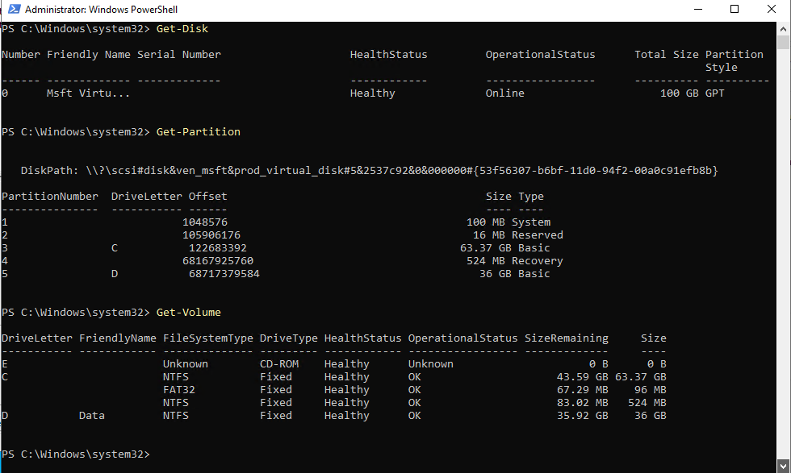

Jeremy Fontenot / Technical portfolio
<h1>APP01 Hyper-V Storage Expansion
</h1>
Practical administration. Documented results. Original technical evidence.

<nav class="contents" aria-label="Case study sections"><a href="#implementation">Implementation</a><a href="#troubleshooting">Troubleshooting</a><a href="#validation">Validation and proof</a></nav><section class="section" id="implementation"><h2>Objective and implementation</h2>
Validate the guest storage state after a personal Hyper-V lab expansion. Technologies: Hyper-V, Windows guest storage, GPT, NTFS, and PowerShell.

The inspected Get-Disk, Get-Partition, and Get-Volume capture shows a healthy online 100 GB GPT disk, a 63.37 GB C: partition, and a 36 GB D: Data volume formatted NTFS.
<h2 id="troubleshooting">Troubleshooting and interpretation</h2>
Disk capacity, partition layout, and filesystem health are separate checks. This capture substantiates the final guest state. It does not independently show the preceding host-side VHDX or checkpoint operations, so those steps are not claimed as verified by this screenshot.
</section><section class="scope"><h2>Scope and limitations</h2>
Personal nested Hyper-V lab storage administration. Claims are limited to the documented VM/disk/guest changes and validation.

Registry status retained in the audit: COMPLETE
. Evidence below is assessed by artifact type; this package does not rerun the lab.

<a href="../../evidence/other-projects/7a57e3a84c-MASTER-PORTFOLIO-REGISTRY.md.txt">Read the retained project registry and its stated scope</a>
</section><section id="validation"><h2>Tasks, results, and supporting proof</h2><article class="proof" id="claim-1"><h3>Evidence 1</h3>
The retained guest PowerShell capture shows a healthy online 100 GB GPT disk, C: at 63.37 GB, and a 36 GB Data volume.
<a class="text-link" href="../../evidence/microsoft-365/automation/d21d826355-05-guest-powershell-storage-validation.png">Open 05-guest-powershell-storage-validation.png</a><small>confirmed by visual inspection of Get-Disk, Get-Partition and Get-Volume; captured guest state only</small>

Provenance

Source: evidence-library/projects/on-prem-home-lab/app01-storage-expansion/05-guest-powershell-storage-validation.png

SHA-256: <code>658881d179b75af41d88444f8bb35c926e6bd208247484ca9ea3ca9e41f80890</code>

</article></section>

